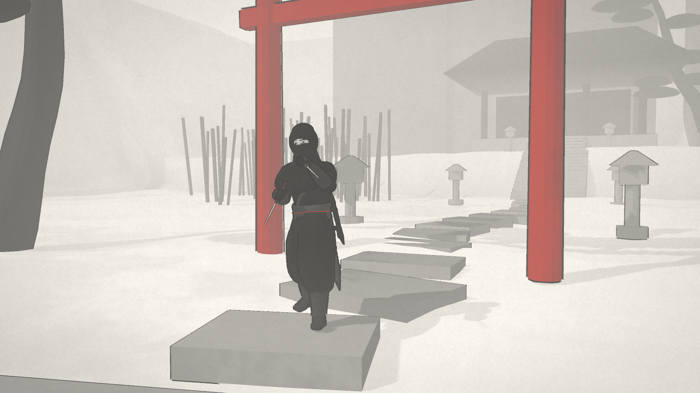

# Sumi no Kage (墨の影)

Third-person hack-and-slash in a living sumi-e ink painting. Godot 4 · GDScript · PC/Steam.



**Current phase: playable slice.** Art bible, three characters on one shared rig (Kage, the Ashen Knight, the Viking Berserker), six weapons, the Kurogane Shrine blockout, ink rendering and brushstroke VFX, a validated headless asset pipeline, and a first playable combat slice with a main menu and enemies. See [`docs/asset_register.md`](docs/asset_register.md) for exact status, including what is placeholder.

## Quick start

```sh
make all        # textures → .blend sources → glTF → Godot import → validation  (~15 s)
make renders    # refresh docs/renders (Godot step opens a window briefly)
/Applications/Godot.app/Contents/MacOS/Godot --path game   # play: main menu -> playable slice
/Applications/Godot.app/Contents/MacOS/Godot --path game res://scenes/showcase/showcase.tscn   # asset viewer
```

**Playable slice:** pick a character and weapon on the main menu, then clear the Kurogane Shrine courtyard of five sentinels.
Controls: WASD move · mouse look · LMB light combo · RMB heavy · Shift block (tap just before a hit = parry → stagger) · Space dodge (i-frames) · E Phantom Step · F (or LMB) finisher on a staggered foe · Tab lock-on · 1–6 switch weapon · Esc pause. Gamepad is mapped too.
Combat tuning lives in `game/data/movesets.json`; automated playtest: `godot --path game res://scenes/game/game.tscn -- --autoplay --shots=5,12,20`.
Showcase keys: `1`–`6` cameras · `C` next character · `W` next weapon · `Space` Phantom Step · `F` spin-slash trail demo.

Roster: Kage (dual daggers), the Ashen Knight (halberd), the Viking Berserker (greatsword), Mugai the Straw Ronin (katana). Weapons: dual daggers, Kuzuri handblades, halberd, naginata, greatsword, broadsword, katana (key 7). See [docs/characters_knight_viking.md](docs/characters_knight_viking.md) and [docs/character_ronin.md](docs/character_ronin.md).
Playtest any roster member: `godot --path game res://scenes/game/game.tscn -- --autoplay --character=ronin --shots=3,6`.
Rig, pose library and dagger combo: [docs/rig_and_animation.md](docs/rig_and_animation.md).

Requires Blender 5.x and Godot 4.7 (paths are overridable: `BLENDER=… GODOT=… make all`). Python is only Blender's bundled interpreter plus the system `python3` for one small config script. No pip packages.

## Platformer prototype (branch `feat/platformer`)

A side-scrolling take on the same world: descend from the Kurogane Shrine through the mine beneath it, past goons, an Oni Captain and the Drowned Maw, with three coloured-ink heroes (Swordsman, Gunslinger, Archer) you can swap between at any time. A rift to a neon far shore is sealed, for now. See [docs/platformer.md](docs/platformer.md).

```sh
/Applications/Godot.app/Contents/MacOS/Godot --path game res://scenes/platformer/platformer.tscn
```

## Layout

```
assets_src/          generated .blend sources (characters/, weapons/, environments/)
tools/
  asset_manifest.json   source → game mapping, budgets, status (drives export + validation)
  blender/              build_kage.py, build_daggers.py, build_shrine_blockout.py, export_assets.py, lib/
  textures/             procedural ink textures, palette swatch
  validate/             Blender-side validator
  configure_godot_imports.py, capture_godot.sh
game/                Godot project
  assets/              imported .glb (characters/, weapons/, environments/)
  shaders/             ink_surface, ink_outline, ink_blade, ink_stroke_vfx, ink_blot_particle, ink_backdrop, ink_sky, ink_post
  data/                ink_materials.json, weapons/*.tres (WeaponDefinition)
  materials/           generated ink materials (+ vfx/)
  scripts/             data/, combat/ (WeaponMount), vfx/ (InkTrail, InkBurst, PhantomStepVFX), showcase/
  tools/               build_materials.gd, validate_assets.gd, import/ink_post_import.gd
docs/                art bible, design and spec docs, renders/, reference/
build/reports/       validator + capture reports (generated)
```

## Docs
- [Art bible](docs/art_bible.md)
- [Kage: character design, model and rig spec](docs/kage_character_design.md)
- [Knight and Viking](docs/characters_knight_viking.md)
- [Weapon design language: daggers, halberd, handblades](docs/weapon_design_language.md)
- [Environment 01: Kurogane Shrine concept and blockout](docs/environment_kurogane_shrine.md)
- [Ink rendering, materials and VFX](docs/ink_rendering.md)
- [Asset pipeline and conventions](docs/asset_pipeline.md)
- [Asset register](docs/asset_register.md)
