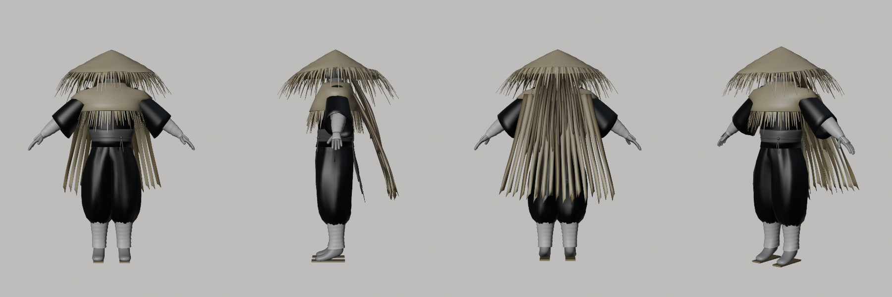
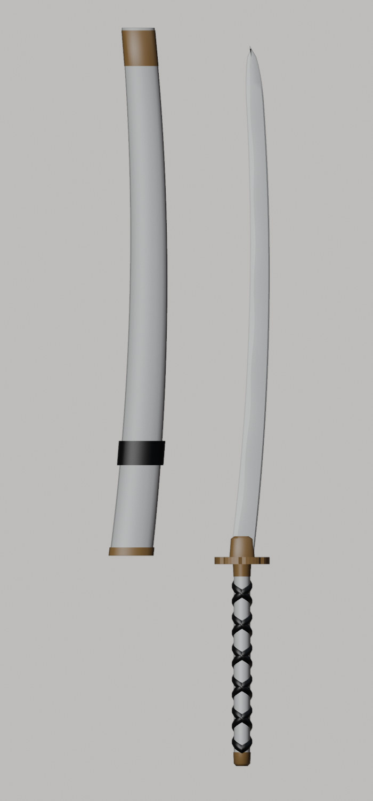

# Mugai, the Straw Ronin

Reference: `docs/reference/characters/outlaw.jpeg` (figure), `docs/reference/weapons/katana.jpeg` (weapon).
Scripts: `tools/blender/build_ronin.py`, `tools/blender/build_katana.py` (`make ronin katana`).

**Figure.** A wanderer under a wide, shallow woven *kasa* whose ragged fringe hides the eyes; a straw *mino* (shoulder mantle with a ragged hem, long straw down the back to the knees); black kimono with wide sleeves and hakama; grey obi; forearms, hands and shins bound in bandage; straw *waraji* sandals; long unkempt hair falling from under the hat.
Same skeleton, control rig and clips as the rest of the roster. Chains: `Tie*` = hair, `Sash*` = obi tails, `Cape1-3` = the mino (spring-simulated in game, tuned stiff so it cannot flip over the hat).
44.9k tris (budget 45k), 1.80 m with the kasa.

**Ink translation.** Straw and bandage are pale *kinari* tones, cloth is sumi, hair a warm mid grey. No red on the figure.

**Katana.** Curved shinogi-zukuri blade with a wavy hamon band, round scalloped tsuba, ito wrap built as two crossing helices over white same (the reference's diamond pattern), tan fittings, white lacquer saya with a black kurikata band. Plays the two-handed sword moveset (`Greatsword` family) until a katana set is authored; that set's clips put the off hand 0.13 m up the grip, so the main hand sits low on the tsuka.
