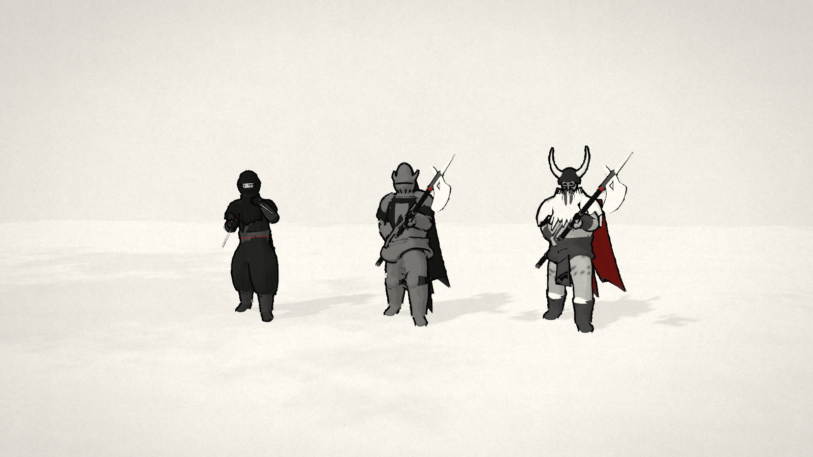
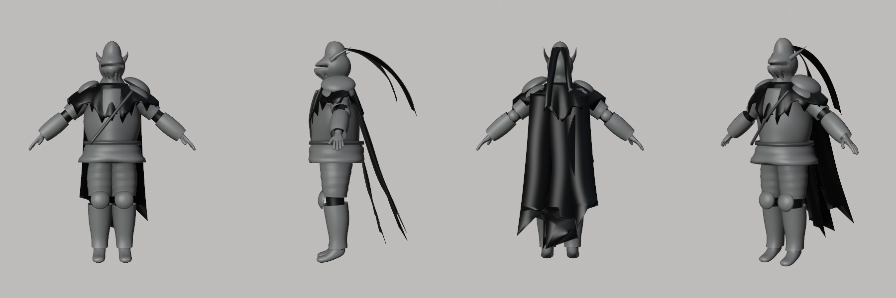
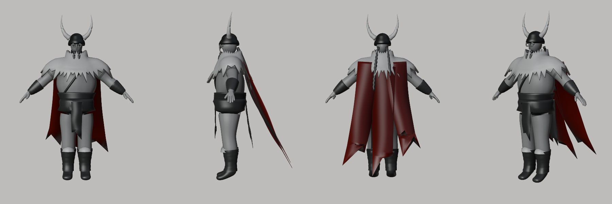

# Roster: the Ashen Knight and the Viking Berserker

*Kage, the Ashen Knight and Bjarnulf the Berserker, each with a default weapon, in engine.*

All three characters are built on **one skeleton**: the same joint layout, Godot humanoid bone names, sockets and clips. Any weapon and any animation therefore works on any character. The heavier builds come from `build_body(girth, torso)`; the knight and viking add three `Cape*` cloth chains (97 deform bones, budget 100). Shared construction lives in `tools/blender/lib/armor_kit.py`.

| | Ashen Knight | Bjarnulf the Berserker |
|---|---|---|
| Reference | `docs/reference/characters/knight1.jpeg` (preferred over knight2/3) | `docs/reference/characters/viking.jpeg` |
| Script | `tools/blender/build_knight.py` | `tools/blender/build_viking.py` |
| Triangles | 38.8k | 28.5k |
| Height | 1.86 m (helm) | 2.07 m (horns) |
| Default weapon | Kurogane halberd | Kurogane halberd |
| Tie chains drive | helm plume | hair braids |
| Sash chains drive | tabard tails | rear kilt flaps |
| Cape chains drive | tattered black cape (3 strips) | red cape (3 strips) |

**Ashen Knight:** a beaked hounskull great helm with a crest, swept fins, an eye slit with **red eye glints** (the reference's red eyes are the knight's only red), and breathing slots. A layered pauldron, oversized on the left, as in the reference. A keeled breastplate, stepped faulds, rerebraces, couters, vambraces, cuisses, poleyns and greaves. A tattered cowl, a diagonal leather baldric and belt. Steel is *tan* grey (0.40) so the black cloth reads against it.

**Viking Berserker:** a heavy sculpted build (pecs, abs, delts, lats, calves). **Knotwork tattoos are drawn as ink**, baked into the vertex-colour cavity channel, so they are part of the ink shading with no textures. A horned helm with a spectacle guard and nasal, braided beard and hair. A shaggy pale fur mantle with pointed locks, fur boot cuffs, a leather belt and kilt with a buckle and loin panel, laced bracers, arm rings and a chest strap.

> **Art-bible exception:** the viking's red cape is the one sanctioned large vermilion mass in the roster. It is the character's identity in the reference. It uses a darker, ink-loaded shu (0.42, 0.075, 0.06) so it reads as stained cloth rather than a flat colour field.

## Shared clips
`RigTest_ROM`, `Stance_DualDaggers_Idle`, and the new `Stance_Halberd_Idle`. The halberd stance is a two-handed guard built with the rig's **IK controls**: the main hand is placed and oriented so its socket holds the shaft, then the off hand is solved onto the actual shaft line. All of these are blocking or validation clips, not final animation.
