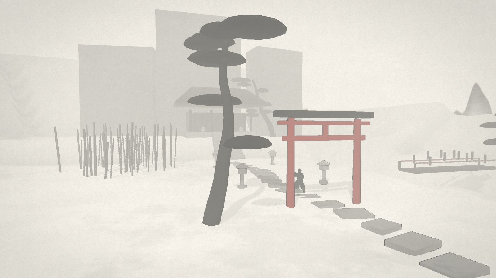
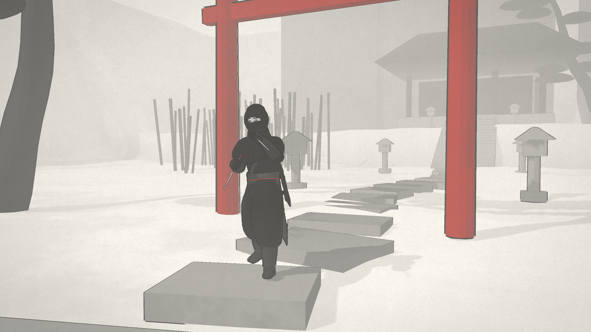
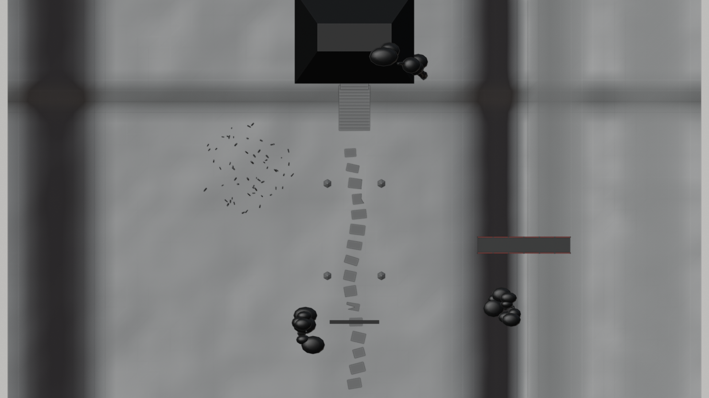

# Environment 01 — Kurogane Shrine (黒鉄神社) — Concept & Blockout

> **Status: BLOCKOUT.** All geometry here is placeholder massing for scale, routes and composition. It is tagged `sumi_status = "blockout"` on every object, and the validators report it as such. None of it is final art.

*In-engine concept frame: blockout geometry through the final ink renderer (fog, backdrop, post).*

## Concept

A mountain shrine at night, swallowed by mist. The player arrives on a stepping-stone path through a lone vermilion torii, crosses a courtyard of stone lanterns, and climbs to a hall on a raised terrace. To the east, a ravine is spanned by an arched red-railed bridge; to the west, a bamboo grove offers cover. Cliffs wall the back of the terrace, and beyond them only *haboku* mountains fading into paper.

**Composition rules**
- Three readable depth planes: foreground (path stones, the gate, the near pine) in *jū*; midground (lanterns, bamboo, hall) in *tan* behind light fog; background (cliffs, mountains) in *sei* to paper.
- The torii is the only large red mass. It frames the hall from the arrival point, so the first view is a composed painting.
- Ground is near paper-white, so the character (the darkest value) always reads.

## Layout (metres, Godot axes: X east, −Z north)

| Area | Where | Gameplay intent |
|---|---|---|
| Arrival / `Marker_PlayerStart` | z = +26 | safe start, framed view through the gate |
| Torii gate | z = +16 | threshold and red focal point |
| Courtyard + lanterns | z = +10 … −2 | open melee arena, 7 m wide path, lantern cover |
| Bamboo grove | x ≈ −14 | stealth approach, vertical occluders |
| Ravine + bridge (`Marker_Ambush_Bridge`) | x ≈ +16 … +28 | chokepoint ambush; the `RavineFence` blocks falls except at the bridge |
| Stone stairs | z = −9 … −15 | 14 steps × 0.215 m up to the terrace (+3 m) |
| Hall terrace + `Marker_Sentry_Hall` | z = −15 … −26 | elevated sentry; the arena for a later boss beat |
| Cliffs | z ≈ −34 | backdrop massing for the mountain wash |

Markers are exported as `Node3D`s for gameplay hookup: PlayerStart, Patrol_A, Patrol_B, Sentry_Hall, Ambush_Bridge, Camera_Concept.

## Collision (generated on import)

Godot name suffixes create the physics: `-col` (trimesh) on terrain, gate, hall, stairs, path, bridge, pines and cliffs; `-convcol` on lanterns; `-colonly` invisible walls for the ravine edge and the play-space bounds. **23** collision objects in total; the showcase uses them to drop the character onto the terrain.

## Budget

14,660 triangles, 9 materials. Blockout pines and bamboo are low-poly stand-ins. The ink treatment (outline, triplanar wash, fog) is already final, so the look of the blockout is representative of the art direction.

## To take this to final art
1. Modular kit in the shrine style: posts, beams, roof tiles with curved eaves, stone wall, steps.
2. Hero pines: real branch structure with brush-card foliage pads (alpha cards textured with `brush_stroke`), wind on the vertex shader.
3. Terrain: sculpted ravine walls and painted *haboku* rock faces.
4. Set dressing: shimenawa rope (red tassels), ema boards, a stone basin, fallen pine needles as ink decals.
5. Lighting pass: lantern pools (the only warm-ish paper tone) and mist volumes as camera-facing wash cards. Volumetric fog stays off until it is justified on target hardware.
