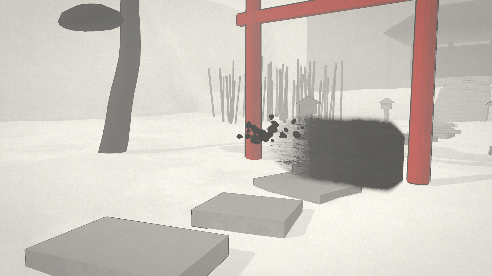
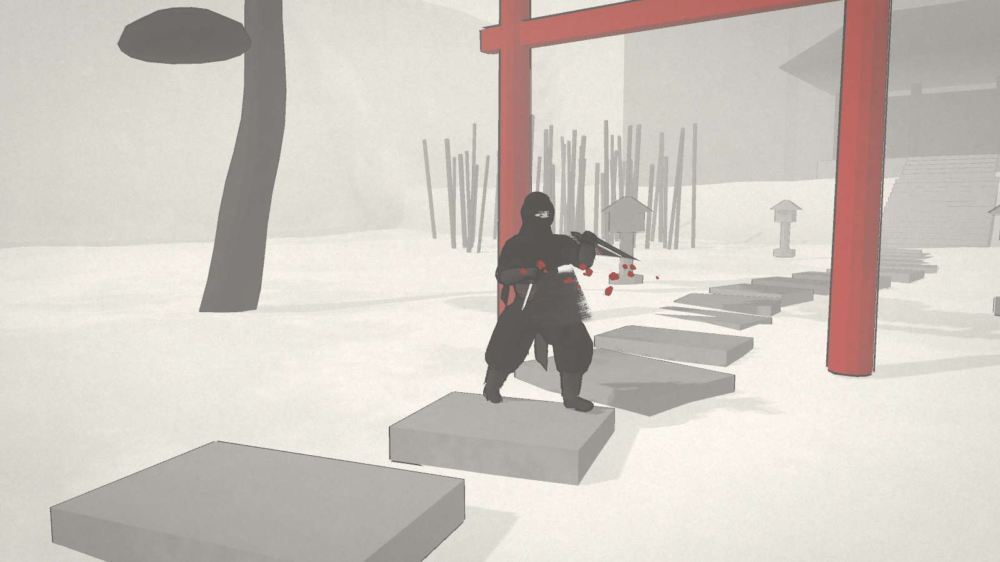

# Ink Rendering, Materials and Brushstroke Effects

*Phantom Step mid-flight: the body has dissolved; a dry-brush streak and an ink splatter mark the path.*

## Shaders (`game/shaders/`)

| Shader | Type | Role |
|---|---|---|
| `ink_common.gdshaderinc` | include | palette constants (paper/ink/shu), hash, triplanar, `sumi_bands()` |
| `ink_surface.gdshader` | spatial | every opaque surface: 2-band ink ramp, wash-broken terminators, bristle streaks, ink rim, cavity pooling, optional triplanar for static meshes, per-instance `dissolve` |
| `ink_outline.gdshader` | spatial, `next_pass` | inverted-hull brush contour; width scales with view depth (constant-ish on screen) and varies with noise |
| `ink_blade.gdshader` | spatial | steel as negative space: hamon, ink spine, inlay channel + ring, stepped glint |
| `ink_stroke_vfx.gdshader` | spatial, unshaded, alpha | weapon trails / step streak: brush texture that dries out with per-vertex life |
| `ink_blot_particle.gdshader` | spatial, unshaded, alpha | billboard splatter, random blot from a 4×4 atlas, dries by noise threshold |
| `ink_backdrop.gdshader` | spatial, unshaded, alpha | *haboku* mountain bands on wrap-around cylinders |
| `ink_sky.gdshader` | sky | paper with a wash bloom and an ink moon |
| `ink_post.gdshader` | canvas_item, full screen | palette enforcement (value only, except vermilion), washi grain, edge darkening |

## Material library (data-driven)

`game/data/ink_materials.json` → `game/tools/build_materials.gd` → `game/materials/M_*.tres`.

- The **Blender material name is the contract.** `M_Kage_Cloth` in a `.blend` becomes `res://materials/M_Kage_Cloth.tres` in Godot, swapped in at import by `game/tools/import/ink_post_import.gd`. Blender materials are previews only.
- To add or tune a material, edit the JSON and run `make godot-import`. Nothing is hand-edited in the inspector.
- Outline width per material (`outline`, metres at 1 m); 0 disables the outline pass.

Per-instance effects use `instance uniform` (`dissolve`), so one material serves any number of characters.

## Textures (`game/textures/ink/`, generated)

`tools/textures/generate_ink_textures.py` (numpy, fixed seeds; spectral synthesis makes them tileable by construction):

| Texture | Channels |
|---|---|
| `paper_grain.png` 512² | R grain, G cloud, B tooth |
| `ink_wash_noise.png` 512² | R large blooms, G medium, B fine bleed |
| `brush_stroke.png` 1024×256 | R density, G bristle streaks, B dryness gradient, A coverage |
| `ink_blots_atlas.png` 1024² | 4×4 splats: R density, G wet rim, B noise, A coverage |
| `mountain_layers.png` 2048×1024 | 4 tileable range bands: R wash density, G vertical strokes, B noise, A coverage |

## Brushstroke effects (`game/scripts/vfx/`)

| Script | What | Cost |
|---|---|---|
| `InkTrail` | records blade base/tip each frame and rebuilds an `ImmediateMesh` ribbon with Catmull-Rom subdivision (stays round at low frame rates); u runs head→tail, vertex alpha = life | 1 draw call, ≤ ~400 verts |
| `InkBurst` | one-shot `GPUParticles3D` splatter (ink or vermilion), shared process material | 1 draw call, 18–30 particles |
| `PhantomStepVFX` | tweens `dissolve` on every geometry instance of the body, draws the path streak with an `InkTrail`, bursts at both ends | reuses the two above |

The showcase demo loop (`game/scripts/showcase/showcase.gd`) fires a spin-slash every 4 s (trails from the real dagger sockets, plus a red burst) and a Phantom Step two seconds later. The spin-slash is a procedural rotation, used only to drive the trails; it is **not** an attack animation.

## Performance notes (M3 Pro, 1600×900, Forward+)

Measured during capture (`build/reports/capture.log`). These are indicative, not a benchmark: the capture window is unfocused, and FPS includes PNG readback.

| Shot | Draw calls | Primitives |
|---|---|---|
| hero (character + shrine + backdrop) | 295 | 233k |
| env concept frame | 236 | 81k |
| character studio | 146–206 | 143–213k |

Primitive counts include the outline pass (×2 on outlined meshes) and two shadow cascades. Features deliberately **off**: SSAO, SSIL, SSR, SDFGI, volumetric fog, glow, TAA. MSAA 2×. Cheap levers if needed later: drop outlines on far LODs, one shadow cascade, merge blockout meshes.
