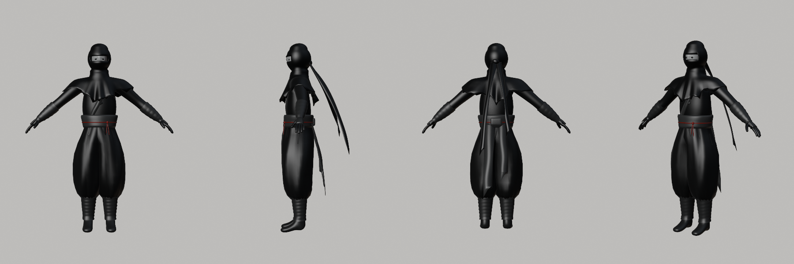
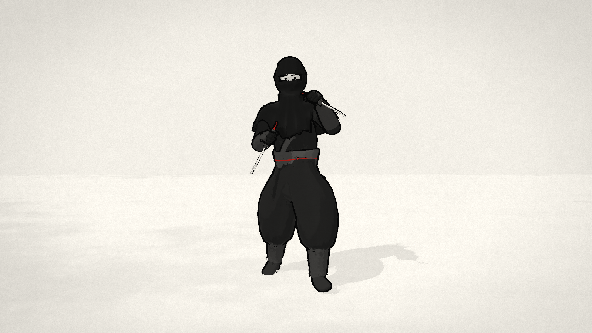
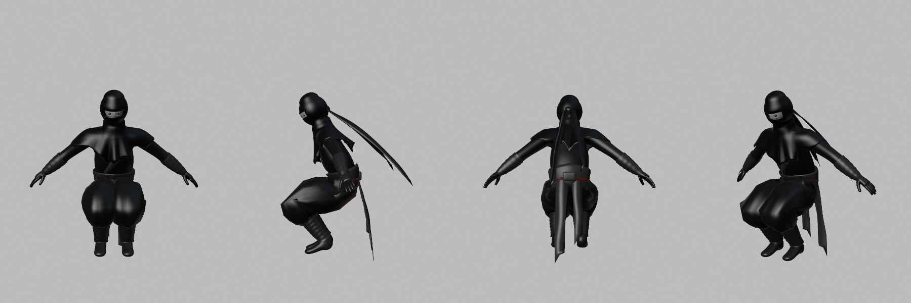
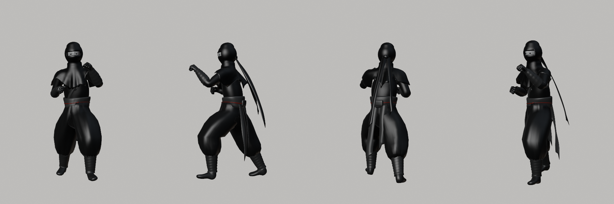

# Kage (影) — Character Design, Model and Rig Spec

*Source turnaround (Blender workbench preview: material values, no ink shading).*

## Design

A shinobi who is barely more than a shadow with a pair of eyes. The figure is built from flowing, tapering verticals so it reads as one brushstroke:

| Element | Purpose in the silhouette |
|---|---|
| **Zukin** — hood, face mask and shoulder mantle as *one* cloth | rounded head mass, a single pale eye slit as the focal point, a tattered mantle that rides up over the arms |
| **Hood ties** (2, asymmetric 0.92 / 0.74 m) | the signature streaming lines from the back of the head; cloth-bone chains |
| **Kimono jacket** with crossed collar (left over right) | the collar V is the one light-grey diagonal on the torso |
| **Obi** in *jū* tone with a **vermilion cord** and knot | the waistline accent; the only red on the body |
| **Obi tails** (2, 0.62 / 0.48 m) | rear vertical tatters that trail in motion; cloth chains |
| **Hakama** wide to the knee, gathered into **shin wraps** | the classic shinobi lower-body shape; widens the stance |
| **Tekko** arm guards and hand plates, spiral-bound | lighter value on the forearms, so dagger hands read against the body |
| **Tabi** and gloves | dark extremities |
| Two **saya** worn horizontally on the lower back | weapon storage (part of the dagger asset, mounted by socket) |

Red discipline: the obi cord, knot and tassels. Nothing else on the costume is red.

## Model (final-v1)

| | |
|---|---|
| Height | 1.74 m crown, 1.80 m with hood |
| Triangles | **36,588** (budget 45k) across 26 meshes |
| Materials | 9: Cloth, Hood, Wrap, Glove, Tabi, Sash, Skin, Eye, AccentRed |
| Vertex colour | R = baked cavity (ink pooling), G = height gradient |
| UVs | loft-generated (u around / v along) on garments for brush streaks; smart-projected elsewhere |
| Source | `assets_src/characters/kage/kage.blend`, built by `tools/blender/build_kage.py` |

Construction (all procedural and reproducible):
1. **Body:** a skin-modifier base mesh driven by the joint layout in `tools/blender/lib/kage_skeleton.py`, which the rig uses too. Regions hidden under garments are deleted (no z-fighting, ~40% fewer body tris); hands become gloves and feet become tabi by material region.
2. **Garments** are lofted ring-by-ring and *fitted by ray casting* against the full body, so nothing clips in the rest pose. Folds, pleats, the ragged mantle hem and the spiral bindings are generated from functions, not sculpted.
3. **Head:** an ellipsoid sculpted analytically (brow, sockets, nose bridge, cheekbones). Only the eye band is ever visible.

Known simplifications, accepted for v1:
- The underlying anatomy is simplified (it is almost entirely covered). Hands are serviceable at gameplay camera distance; for close-up cinematics they would need a sculpted pass.
- No authored LODs yet. Godot's importer generates LODs automatically (`meshes/generate_lods=true`).
- `Kage_Body` still carries 14.6k triangles, mostly the gloves' fingers. Decimating the remaining torso would save ~4k if needed.

## Rig

**79 deform bones + 8 control bones.** Deform bone names follow Godot's `SkeletonProfileHumanoid`, so animation retargeting works with the default BoneMap. Validation checks every profile bone is present.

| Group | Bones |
|---|---|
| Core | Root, Hips, Spine, Chest, UpperChest, Neck, Head, LeftEye, RightEye |
| Arms (×2) | Shoulder, UpperArm, LowerArm, Hand |
| Fingers (×2) | Thumb Metacarpal/Proximal/Distal; Index, Middle, Ring, Little: Proximal/Intermediate/Distal |
| Legs (×2) | UpperLeg, LowerLeg, Foot, Toes |
| **Weapon sockets** | `LeftHandWeapon`, `RightHandWeapon` (fist centre), `LeftSheathBack`, `RightSheathBack` |
| **Cloth chains** | `TieL_01–06`, `TieR_01–05` (from Head), `SashL_01–05`, `SashR_01–04` (from Hips) |
| Controls (source only) | `CTRL_IK_Hand.L/R`, `CTRL_Pole_Arm.L/R`, `CTRL_IK_Foot.L/R`, `CTRL_Pole_Leg.L/R` |

- **Rest pose:** A-pose, arms 40° below horizontal. That gives better shoulder deformation than a T-pose; Godot's retargeter handles the difference.
- **IK/FK:** two-bone IK on arms and legs, with influence driven by armature custom properties `ik_arm_L/R` and `ik_leg_L/R` (0 = FK). Control bones are non-deforming and stripped at export (`export_def_bones`); constraint results are baked by sampling.
- **Bone collections:** Body, Fingers, Cloth, Sockets, Controls.
- **Skinning:** bone-heat weights on a hidden full-body proxy (body + head), transferred to every garment by nearest-face interpolation. Hakama and cloth chains use analytic weights (along-leg and along-chain blends). All meshes have at most 4 influences, normalised, and every vertex is weighted; both validators enforce this.

### Weapon socket frame

*HandWeapon sockets sit at the centre of the closed fist. **In Godot:** +Y points out of the thumb side (blade direction for a forward grip) and +Z toward the knuckles (cutting edge). Every one-handed weapon is authored in this frame (see `asset_pipeline.md` § Conventions), so a weapon attaches at identity. Reverse grip is a 180° turn about Z, applied by `WeaponDefinition.grip_mode`, not by a separate mesh.

### Rig validation clips (not final animation)

| Clip | Frames | Purpose |
|---|---|---|
| `RigTest_ROM` | 1–133 | spine flex/twist/side-bend, arms up/down/forward, elbows, fists, leg raises, a deep crouch |
| `Stance_DualDaggers_Idle` | 1–61, looping | blocking pose for the reverse-grip dagger guard with a breathing cycle |

The stance is a **blocking pose**, made to validate sockets, grip and silhouette. It is not a shipped animation.

## Next steps for this asset
- Spring bones: put `SpringBoneSimulator3D` on the Tie/Sash chains, with collision capsules on the legs and spine.
- Author combat animations (in Blender against the IK rig, or retargeted mocap via the humanoid profile).
- Close-up pass: sculpted hands, an eyelid blink (the eye bones are already present).
