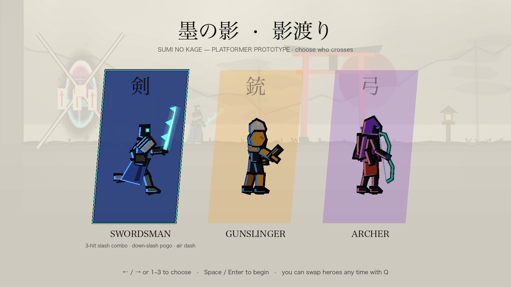
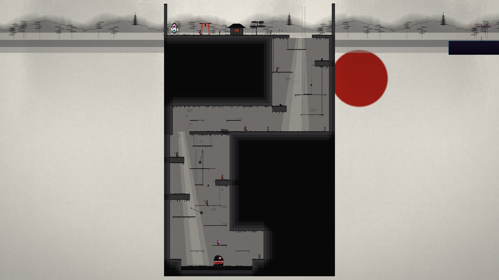
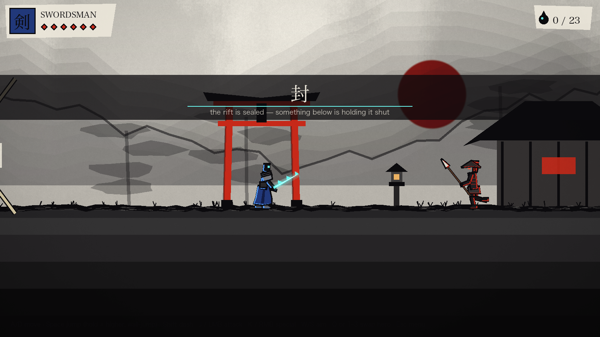
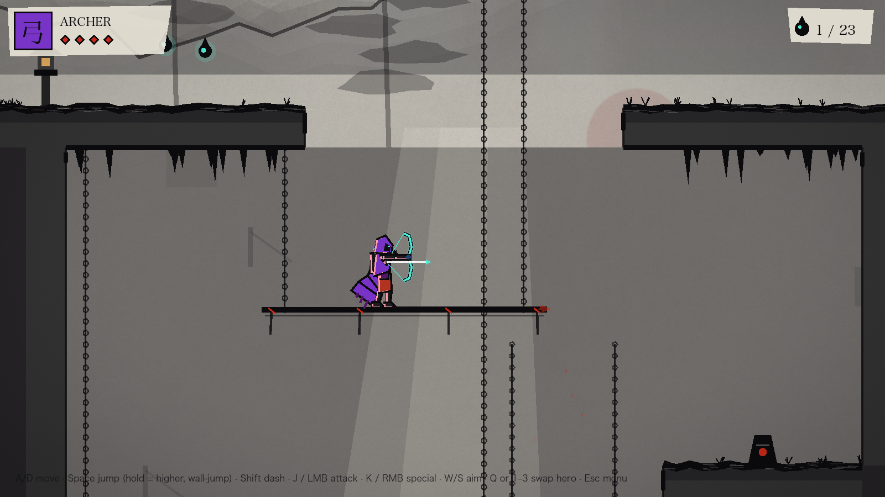
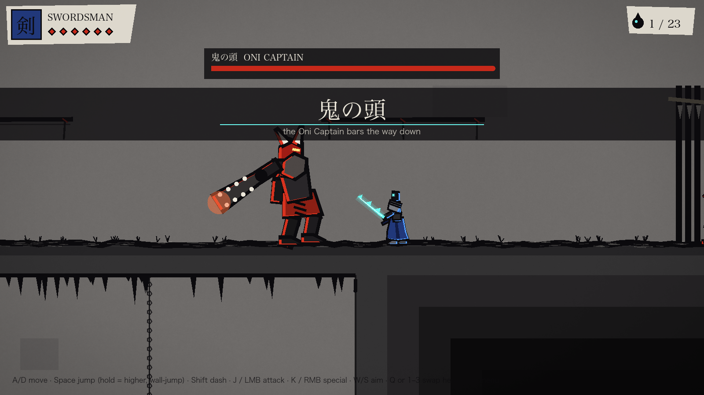
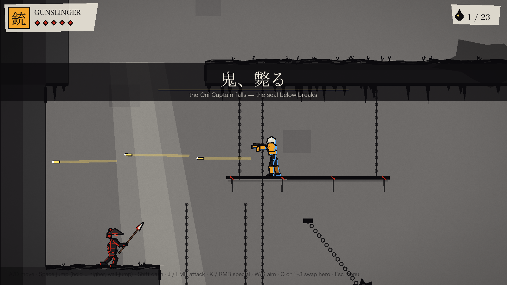
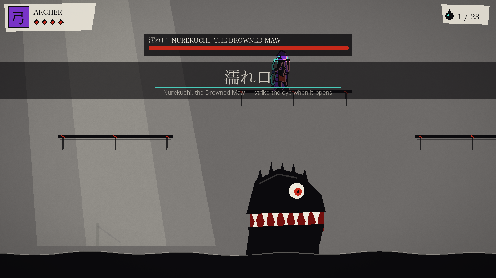
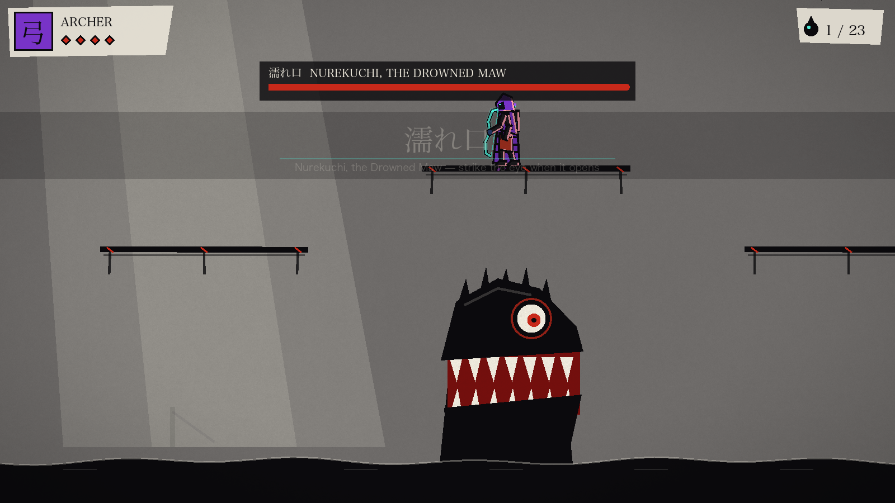

# 影渡り Kage-watari: platformer prototype

An exploration branch: the same world turned into a side-scrolling action platformer, with a different feel. The heroes are painted in **coloured ink** and stand out against a monochrome sumi-e world. A rift has torn open over the Kurogane Shrine and leads to a neon far shore, **Higan (彼岸)**. **The rift is sealed for now:** the playable stage is entirely in ink.



## The stage: down through the shrine mine

The layout follows `docs/reference/platformer/layout.jpeg`, a vertical descent:



1. **Shrine yard (surface).** Spawn beside the sealed rift (封, bound with rope and ofuda), with a torii, a hall, and a yari goon to warm up on. The mine mouth opens at the right.
2. **Right shaft.** Daylight falls through the mouth. On the way down: chain-hung planks, a bell turret on a shelf, a goon on the scaffold, a vertical chain lift, a long one-way walkway, then a checkpoint at the bottom.
3. **The passage: Oni Captain (mini-boss).** Step in and a gate of ink bars shuts behind you. The drop to the next shaft is sealed by a lid that only breaks when he falls.
4. **Left shaft.** Swinging maces over planks, a sideways lift, archer and yari goons on ledges, wisps, and a checkpoint halfway.
5. **The pit: Nurekuchi, the Drowned Maw (boss).** It lives in an ink pool, and the pool burns. A ripple stalks your x position (that is the tell), then it bursts up in a bite that reaches the low platforms but not the high one. Afterwards it hangs open with its eye exposed, and that is your window to hit it. Below half health it stalks faster, spits ink on surfacing, and calls two wisps.

| Yard | Right shaft | Oni Captain |
|---|---|---|
|  |  |  |
| **Left shaft** | **The Maw stalks** | **The Maw opens** |
|  |  |  |

The map is ASCII in `pf_level.gd` (`ZONE_SHRINE`, legend in the file header), so you can redesign the level in a text editor. Bosses reset if you die mid-fight, and you respawn at the last checkpoint banner.

## Foes

| | Behaviour | Tell |
|---|---|---|
| Yari goon (ashigaru) | patrols, spots you within ~6 tiles, closes in, lunges | vermilion "!" tick + glowing spearhead wind-up (a hit cancels it) |
| Archer goon | holds a ledge, arcs arrows at you | full draw with "!" tick |
| Ink oni / wisp / bell | crawler, homing flyer, lobbing turret | — |
| **Oni Captain** (24 HP) | walks you down, club slam + floor shockwave (jump it), leaps every third attack. Phase 2: faster, waves go both ways | club raised and glowing |
| **Drowned Maw** (40 HP) | stalk → bite (2 dmg) → open (vulnerable) → dive, loop | ripple + vermilion mark on the pool |

Goons and the Oni are drawn by the same puppet rig as the heroes: ink bodies with a vermilion rim instead of a coloured one.

## Heroes

| | Swordsman 剣 | Gunslinger 銃 | Archer 弓 |
|---|---|---|---|
| Reference | Mercenary | Commando | HLD Sentient |
| HP | 6 | 5 | 4 |
| Attack | 3-hit slash chain | hold: alternating pistols | hold to draw, release. A full draw pierces (3 dmg) |
| Special | rising slash | 5-shot fan | 3-arrow volley |
| Trait | down-slash **pogo**. Dash cuts | aim down in the air to **hover on recoil** | **double jump**, **cloak glide** |

You can swap heroes at any time with Q or 1/2/3. HP carries over as a fraction.

## Play

```sh
/Applications/Godot.app/Contents/MacOS/Godot --path game res://scenes/platformer/platformer.tscn
# or main menu → "影渡り Platformer (prototype)"
# scripted capture + smoke test (writes build/playtest/pf_*.png):
/Applications/Godot.app/Contents/MacOS/Godot --path game res://scenes/platformer/platformer.tscn -- --pf-shots
```

Controls: A/D move · W/S aim · Space jump (hold for height, wall-jump, glide) · Shift dash · J/LMB attack · K/RMB special · Q or 1–3 swap · Esc menu. Gamepad is mapped too.

## Structure

All the code is new and lives under `game/scripts/platformer/` (prefix `PF`). The 3D slice is untouched apart from one main-menu button.

| File | What |
|---|---|
| `pf_level.gd` | ASCII zones, spawning, camera (looks ahead when falling, frames the pit during the Maw fight), checkpoints, pits, spikes, pool, boss triggers, sealed rift, `--pf-shots` |
| `pf_hero.gd`, `pf_heroes.gd`, `pf_rig.gd` | movement + weapons. Palettes and stats (heroes and foes). Procedural FK puppet with ink outline, rim sliver and verlet cloth |
| `pf_enemy.gd` | crawler / flyer / turret / goon / bowgoon (ink and neon skins) |
| `pf_oni.gd`, `pf_maw.gd` | the two bosses |
| `pf_hazards.gd` | Mace, Lift (one-way AnimatableBody2D), Gate (arena gate and lid) |
| `pf_terrain.gd` | collision from the map + painting: rock lit at its skin and solid ink inside, cave back wall, daylight beams, stalactite drips, chains |
| `pf_backdrop.gd`, `pf_fx.gd`, `pf_shot.gd`, `pf_hud.gd`, `pf_world_art.gd` | parallax, VFX, projectiles, HUD + boss bar + select, pickups and checkpoints |
| `shaders/platformer/` | sky, rift, colour-keeping washi post pass with an ink-flood wipe |

**Unlocking the rift:** set `PORTAL_LOCKED := false` in `pf_level.gd`. The neon zone (`ZONE_NEON`) and the crossing transition are still built and still work.

## Open questions
- Should the Maw's death unseal the rift? Right now the card says it is still sealed.
- Tuning. Nothing has been played by a human yet. The checks so far are a scripted bot run plus forced states for the screenshots: the Oni is killed by script to prove the lid opens.
- Art: the procedural puppets prove out the silhouettes and palettes. The open choice is hand-drawn frames versus authored keyposes on this rig.
- Audio is still missing.
