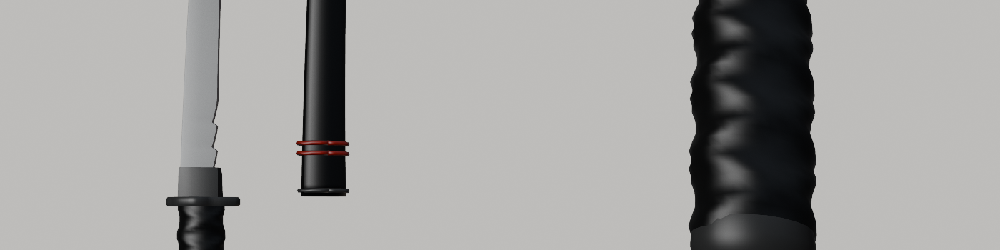
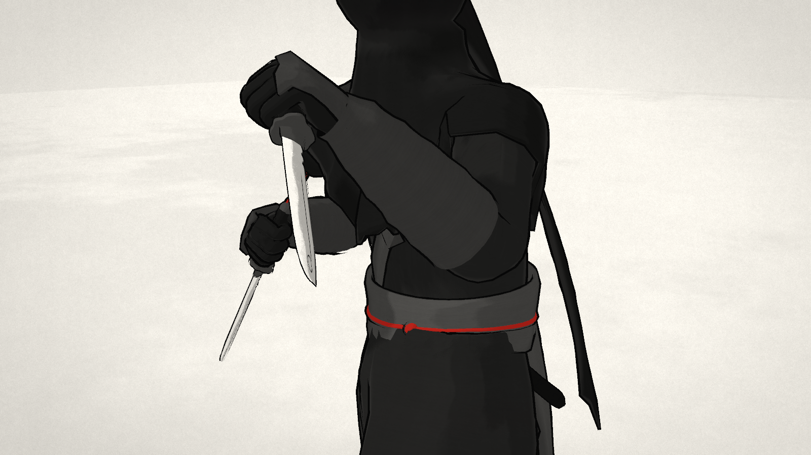
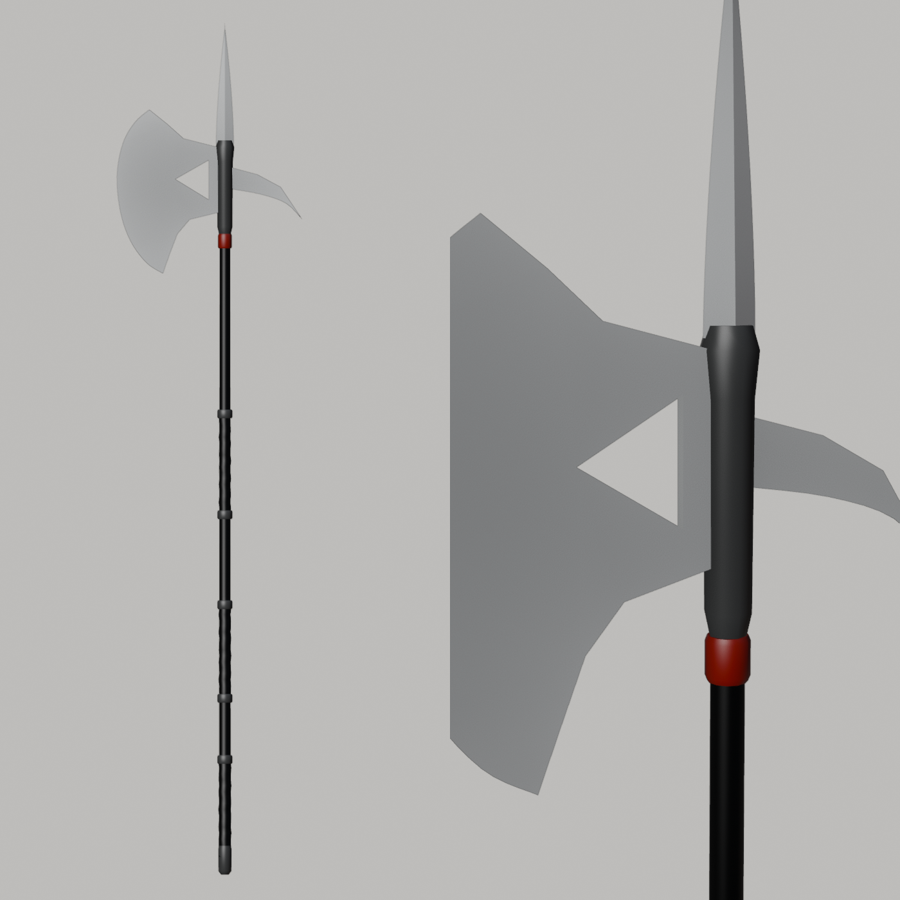
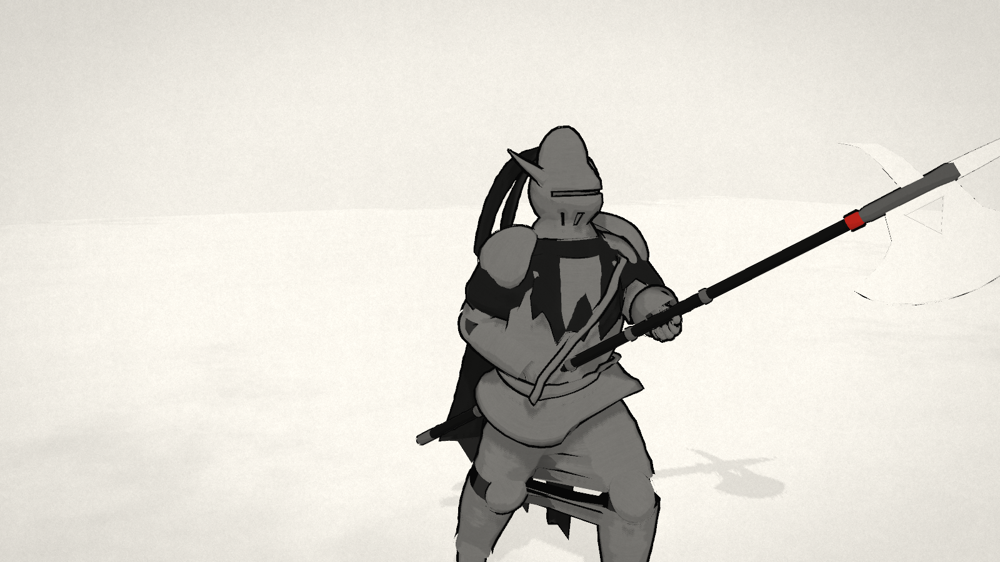
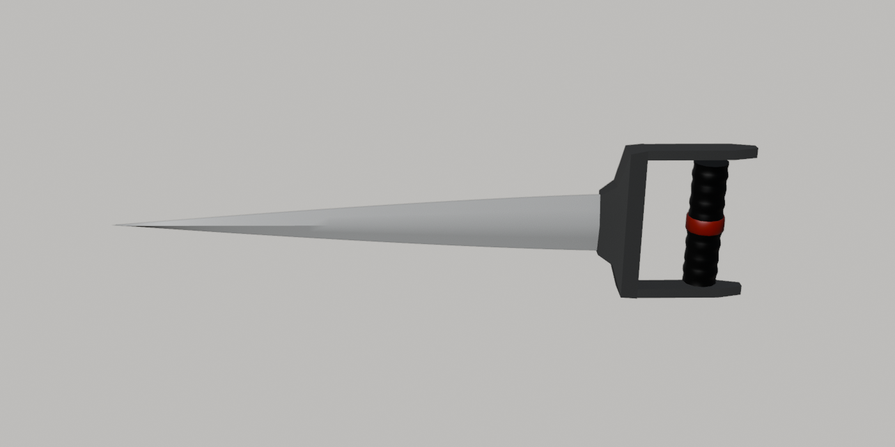
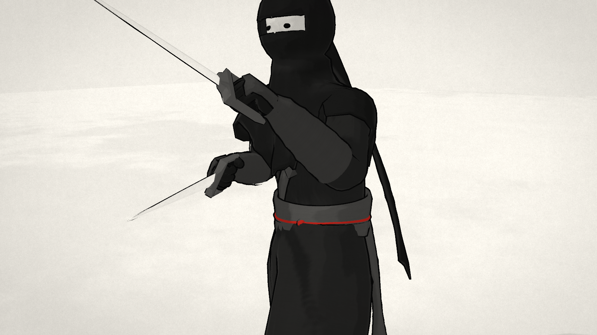

# Weapon Design Language

## Kagenui (影縫, "shadow-stitch"): dual daggers (final-v1)

| | |
|---|---|
| Type | matched pair of *tantō*-style daggers, held reverse-grip in the default stance |
| Length | 0.364 m kashira to tip (0.42 m with the tassel); blade 0.232 m |
| Blade | *hira-zukuri* section (flat sides tapering to the edge), *koshi-zori* curvature toward the spine, *fukura* tip, **three back-cut spine notches** near the base |
| Fittings | ink-blot *tsuba* (an irregular outline, like a drop of sumi on washi), *habaki* collar, oval *tsuka* with a raised diamond wrap in the geometry, *kashira* cap |
| Accent | vermilion cord loop and tassel at the pommel; vermilion *sageo* bands on the saya |
| Saya | black-lacquer scabbard following the blade curve, metal mouth ring; worn horizontally on the lower back (`*SheathBack` sockets) |
| Triangles | dagger 6,000; saya 1,588 |
| VFX sockets | `Socket_BladeBase`, `Socket_BladeTip` (empties exported as nodes; trails sample between them) |
| Shader | `ink_blade.gdshader`: pale negative-space steel, hamon line, hard ink spine (*mune*), the family **inlay** (a fuller channel and a ring mark near the base), a stepped view-dependent glint |

The inlay colour is a material parameter (`inlay_color`): ink-black by default, vermilion for an upgraded/cursed variant.

## Kurogane halberd (final-v1)

From `docs/reference/weapons/halberd.jpeg`: a crescent axe with the reference's **triangular window**, a back fluke hooking toward the butt, a diamond-section top spike, an iron socket, and a wrapped, ringed shaft. One vermilion binding below the socket. Total length 2.37 m, 3.8k triangles. The origin is at the main-hand grip; `Socket_OffHand` marks the second hand 0.52 m up the shaft. Two-handed, forward grip, `Stance_Halberd_Idle`.

## Kuzuri handblades: katar pair (final-v1)

From `docs/reference/weapons/handblade.png`. Held like a saw handle turned sideways: the wrapped **grip bar runs through the fist** (socket +Y) between two side bars that run back along the forearm, and the needle blade **protrudes past the knuckles** (socket +Z), so the punch is the stab. 1.3k triangles; dual-wield, forward grip, using the dagger guard stance.

## Reference set (supplied, `docs/reference/weapons/`)

Four reference images were supplied for the weapon roster. None is a dagger, so they inform the **family language** and the **future** categories, and were not built in this phase.

| Reference | Category | What we keep | How it translates into ink |
|---|---|---|---|
| `naginata.jpg` | 5 · Naginata | asymmetric leaf blade with a strong belly; **three stepped notches on the spine**; a **ring cut-out** near the base; a glowing **channel** running along the blade; flat square tsuba with a collar; long shaft whose lower half is cord-wrapped in a criss-cross | the notches carry into the Kagenui spine (done); the ring and channel become the ink inlay (done, shader). Magenta glow → ink-black or vermilion inlay, never emissive. Gold fittings → *jū*-grey metal. Yellow cord wrap → dark wrap with vermilion only on the binding knots |
| `greatsword.png` | 3 · Greatsword | long straight blade tapering to a chisel point; faceted, stepped ricasso; angular crossguard with forward-swept prongs; segmented hilt | deep-red blade → pale steel with heavy ink chamfer lines; the faceting becomes hard brush edges (flat-shaded bevels, strong outlines). Keep the stepped ricasso as a silhouette mark |
| `broadsword.png` | 3 · Broad sword | a slab blade, rectangular with a clipped tip; a long thin wrapped grip; a triangular gem set below the guard; a panelled blade face | the slab is the largest negative-space shape in the game; panel lines become ink strokes. Purple gem → an inlaid triangle in ink, or the single vermilion accent on this weapon |
| `gauntlet.jpeg` | — (not one of the five categories) | chunky, blocky fist weapon; stepped zig-zag edges; conical spikes; studs and crystal insets | **Open question for the director:** the brief lists five categories (daggers, longsword, broad/greatsword, rapier, naginata). Is the gauntlet a sixth category, an off-hand item or a mood reference? If built: crystals → ink-black lacquer, blue → *nō*/*jū* values, energy arcs → dry-brush VFX |

## Family rules (all weapons)

1. **Blade = negative space.** Steel is the lightest value on the character; the spine is a hard ink line.
2. **One notch motif.** Every bladed weapon carries a stepped notch group on the spine side, scaled to the weapon. It ties the roster together and reads in silhouette.
3. **One inlay.** A channel and/or ring mark, ink-black by default. Upgrades may turn it vermilion; nothing glows.
4. **Red lives on cord.** Tassels, sageo, binding knots. Never on a blade surface (blood VFX excepted).
5. **Shared frame:** grip centre at the origin; in Godot +Y = blade and +Z = edge (Blender: +Z blade, −Y edge). Two-handed weapons put the origin at the main-hand grip and add a `Socket_OffHand` empty for the second hand's IK target.
6. **Data, not code:** each weapon gets a `WeaponDefinition` resource (`game/data/weapons/*.tres`) with grip mode, sockets, sheath offsets, trail sockets, stance clip and feel parameters.
